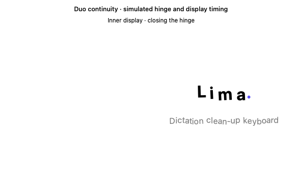
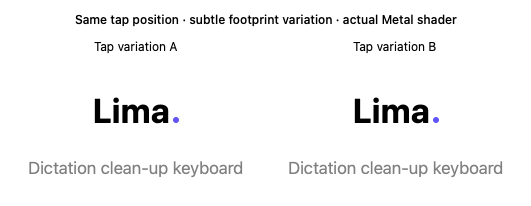

# Welcome interaction previews

These GIFs use the app's SwiftUI letter renderer and Metal ripple shader. Hinge angles, display timing and taps are simulated offscreen.

## Display continuity



The right-hand inner pane and the outer layout retain the same letter displacement. The preview simulates a 300 ms screen-switch gap. The destination briefly retains the letters, then completes their return. The entire handoff expires after one second; late switches shorten the return, and missing destination signals discard stale state.

`ContentView` keeps the state in its existing scene. `HingeLetterMotion` uses angle changes and elapsed time to give slow folds more movement and quick folds a small response. A pause of 180 ms starts a 240 ms return. New motion can interrupt that return from the visible position. After a complete return, the next angle establishes a fresh resting pose: moving from 120° towards 90° or 140° works in either direction.

## Tap variation



Each tap keeps its exact origin and independent lifetime. A random aspect ratio of 0.975–1.025 changes the footprint slightly. The usual size also varies narrowly around 1.45. Refraction strength and the sampling allowance are unchanged.

## Verification

The motion, layout and real-shader checks pass:

```sh
swiftc LimaApp/HingeLetterMotion.swift Tests/HingeLetterMotionCheck.swift -o /tmp/lima-hinge-check
/tmp/lima-hinge-check
swiftc LimaApp/AvailableRegion.swift Tests/AvailableRegionCheck.swift -o /tmp/lima-region-check
/tmp/lima-region-check
swift Tests/RippleCheck.swift
```

The review found an early-return bug during delayed display switches. The fix waits for destination layout/activation instead of animating while unseen. Checks cover both callback orders, delays up to 1.2 seconds, timeout expiry and interrupted returns. Ponytail review removed the unused welcome-placement wrapper and flag.

Hidden handoffs have no animation loop or disk writes. Visible returns reuse the existing timeline, which pauses after completion. Low Power Mode and Reduce Motion restore text immediately.

An Apple M2 shader-only benchmark measured these median GPU times per frame across 252 warmed samples. The small differences do not establish an energy saving. Actual iPhone battery drain remains unmeasured.

| Render scale | Circular baseline | Subtle variation |
|---|---:|---:|
| 2× | 0.0370 ms | 0.0342 ms |
| 3× | 0.0836 ms | 0.0860 ms |

Device checks remain open:

- [ ] Standard iPhone.
- [ ] Duo closed and fully open.
- [ ] Duo partially folded, clear of reserved regions.
- [ ] Opening, closing and folding during use, with actual display-switch timing.
- [ ] Split View or a narrow window.
- [ ] Large Dynamic Type and VoiceOver.
- [ ] Actual iPhone energy measurement.
